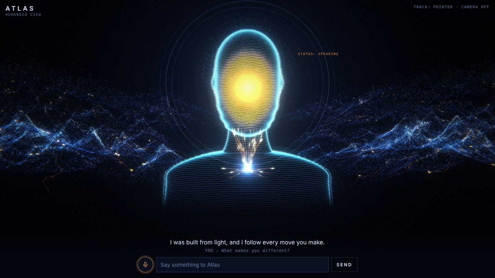
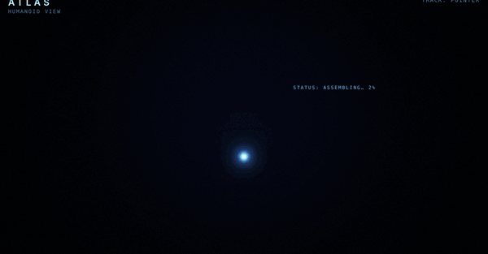
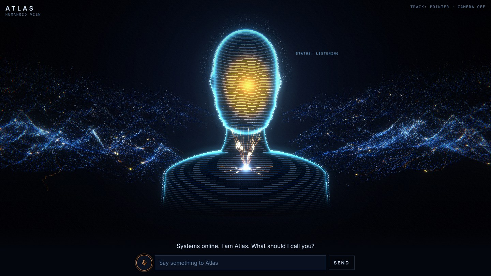
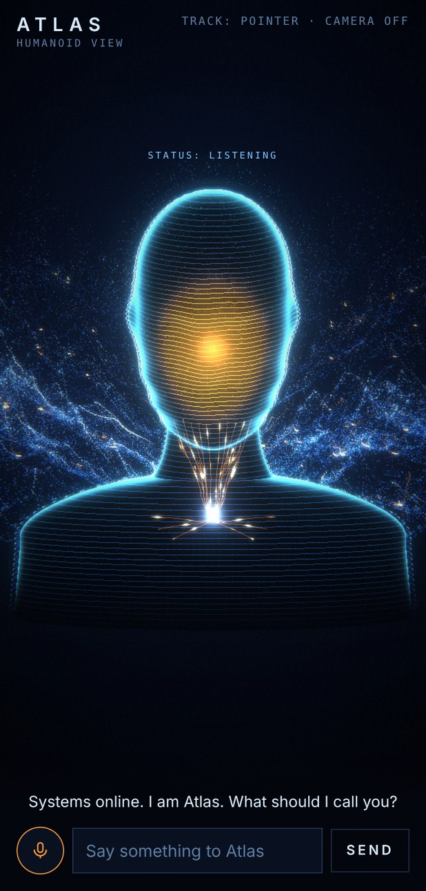

<h1 align="center">Humanoid Atlas</h1>

<p align="center">
  A humanoid made of light that watches you through your webcam, turns its head to follow you,<br>
  listens when you speak, and answers out loud in a deep voice.
</p>

<p align="center">
  
</p>

<p align="center">
  <a href="https://vercel.com/new/clone?repository-url=https%3A%2F%2Fgithub.com%2Fpratikdilliwala%2FHumanoid-Atlas&env=GEMINI_API_KEY,ELEVENLABS_API_KEY&envDescription=Gemini%20powers%20Atlas's%20answers.%20ElevenLabs%20powers%20his%20voice.&project-name=humanoid-atlas"></a>
</p>

---

## What it does

| | |
|---|---|
| **Forms out of light** | Particles spiral up out of a glowing chest node and settle into a head and shoulders, then a range of particle mountains rises behind him. |
| **Follows you** | Face detection in the browser turns his head toward you. If the camera is off, he follows your mouse or finger instead. |
| **Listens** | Tap the mic and talk, or type. Speech recognition runs in the browser. |
| **Thinks** | Quick questions (time, date, your name, jokes) are answered instantly. Everything else goes to Google Gemini. Replies in Hinglish if you speak Hinglish. |
| **Speaks** | Replies are spoken with an ElevenLabs voice. His orange face and the rings around his head pulse with the real audio. |
| **Remembers you** | Tell him your name once and he greets you by it next time. |

<p align="center">
  
</p>

<p align="center">
  
  &nbsp;
  
</p>

## Deploy your own

1. Click **Deploy with Vercel** above (or import this repo in Vercel).
2. Add two environment variables:

   | Variable | Where to get it | Required |
   |---|---|---|
   | `GEMINI_API_KEY` | [Google AI Studio](https://aistudio.google.com/apikey) (free tier, no card) | For open-ended answers |
   | `ELEVENLABS_API_KEY` | [ElevenLabs](https://elevenlabs.io) → Profile → API keys (free tier) | For the deep voice |
   | `ELEVENLABS_VOICE_ID` | ElevenLabs → My Voices → your voice's ID | Recommended: the built-in default is the author's own designed voice |
   | `GEMINI_MODEL` | e.g. `gemini-3.5-flash-lite` (comma-separate fallbacks) | Optional |
   | `ELEVENLABS_MODEL` | defaults to `eleven_flash_v2_5` | Optional |

3. Open your deployment and tap **Wake Atlas**. Allow the camera and microphone.

Without the keys Atlas still works: he uses the browser's own voice and answers his built-in questions.

> **ElevenLabs free plan:** Voice Library voices can't be used through the API on the free plan. Use one of the default voices or design your own under *Voices → Create a voice → Voice Design*.

> **Keep it private:** in Vercel, *Settings → Deployment Protection → Vercel Authentication → All Deployments* makes the site open only for your Vercel account, which also protects your API quotas.

## Run it locally

The camera and the API routes need `http://localhost` or `https`, not a `file://` path.

```bash
npm i -g vercel
vercel link          # connect to your Vercel project
vercel env pull      # download your keys into .env.local
vercel dev           # http://localhost:3000
```

For the visuals only (browser voice, built-in answers): `npx serve .`

## How it's built

```
index.html      Everything you see and hear: Three.js scene, face tracking, speech, replies
api/chat.js     Vercel function → Google Gemini (short spoken replies)
api/speak.js    Vercel function → ElevenLabs text-to-speech (MP3)
```

- **Rendering:** [Three.js](https://threejs.org) r147 with an Unreal bloom pass. The figure is ~25k points and contour lines over a black "shell" mesh whose fresnel edge gives the neon outline. Mountains are ~150k points sampled from a height field of pyramidal peaks carved with ridged noise.
- **Tracking:** [MediaPipe Tasks Vision](https://ai.google.dev/edge/mediapipe/solutions/vision/face_detector) face detector, running entirely in the browser. Camera frames never leave the device.
- **Voice in:** Web Speech API (best in Chrome on Android and desktop).
- **Brain:** Gemini via a serverless function, so the key is never exposed to the browser. Each route has a simple per-minute rate limit.
- **Voice out:** ElevenLabs via a serverless function, played through Web Audio with an analyser that drives the face glow.

Want to change something? `CLAUDE.md` maps where each part lives (figure shape, nerves, mountains, replies, voice).

## Ideas for what's next

- Interview coach mode that asks questions and scores spoken answers
- Morning briefing (calendar, weather, news)
- Wake word ("Hey Atlas") and gesture controls
- Kiosk / receptionist mode for shops and events

## Credits

- Visual concept inspired by a "human interface" reel by **Reznikov Engineering**.
- Built with Three.js, MediaPipe, Google Gemini and ElevenLabs.

## License

[MIT](LICENSE) © Pratik Dilliwala
